# Sydney Bank Customer Churn

## 1. Overview

This project builds a machine learning pipeline to estimate which Sydney Bank customers are most likely to leave.

The business objective is to support retention. The bank cannot contact every customer, so the model ranks people by churn risk and produces a short contact list for outreach.

**Input:** Customer profile: tenure, activity, balance, recent transactions, and related account details 
**Output:** Churn probability, plus a ranked list of customers to contact 

About **18.6%** of customers in the dataset have already churned (297 of 1,600). A useful model is one that puts real churners near the top of the list, because that is who a retention team would call first.

## 2. Business Problem

Losing a customer is more expensive than keeping one, and a blanket campaign wastes effort on people who were going to stay.

Poor targeting can lead to:

- Retention offers sent to customers who are unlikely to leave
- High-risk customers missed until they have already gone
- Staff time spent on a list that is no better than picking names at random
- Weaker results from the same outreach budget

This project helps the bank decide **who to contact first**, using patterns in who has already left.

## 3. Dataset

The dataset is one row per customer. It is stored at `data/sydney_bank_customer_churn.csv`.

| Column | What it means for the bank |
| --- | --- |
| `CustomerID` | Customer identifier. Used on the contact list. Left out of the model. |
| `Age` | Age in years |
| `Gender` | Gender. Raw values were inconsistent (`f`, `F`, `female`, `m`, `M`, `male`) and were standardised to `Female` and `Male`. |
| `TenureMonths` | How long the customer has been with the bank |
| `NumProducts` | Number of products held |
| `IsActiveMember` | Whether the customer is an active member |
| `Balance` | Account balance |
| `NumTransactions_Last6Months` | Transactions in the last six months |
| `ComplaintsLast6Months` | Complaints in the last six months |
| `Churn` | Target. `1` if the customer left, `0` if they stayed. |

## 4. Analysis

Section 4 of `main.ipynb` is the exploratory analysis. The charts below are those figures, saved in `figures/`. They describe the customer base first, then the gaps between people who left and people who stayed, then the combinations where churn is concentrated.

### 4.1. What the customer base looks like

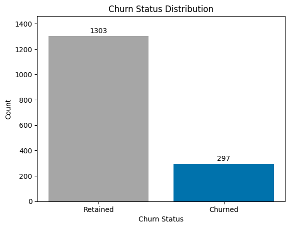

Most customers stay. Of 1,600 people, 1,303 are retained and 297 have churned, so the base rate is 18.6%. A rule that predicts “everyone stays” is right about 81% of the time and still misses every customer a retention team would want to call. That is why the modelling later judges a ranked list.

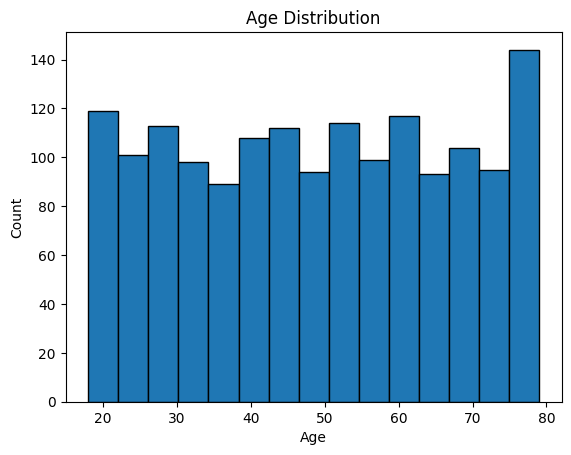

Age runs from 18 to 79 and is spread fairly evenly across that range. The mean is 48.9 years and the median is 49. The oldest bin is a little taller than the rest. No single age band makes up the book.

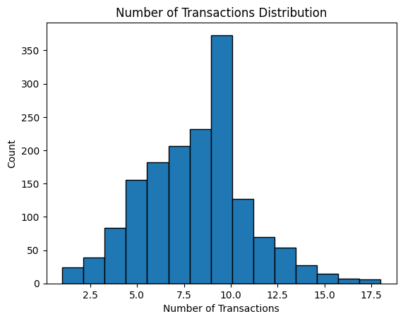

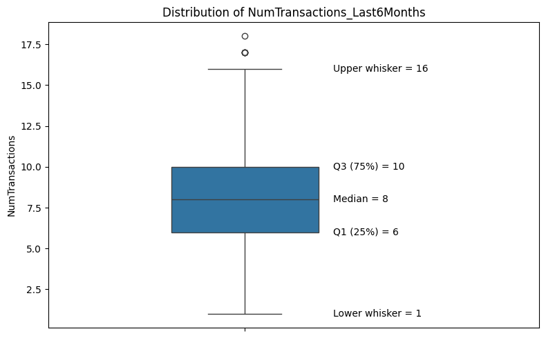

Transactions in the last six months cluster around the middle. The median is 8, and half of customers sit between 6 and 10. The lower whisker is 1 and the upper whisker is 16, with a few customers above that, up to 18. The typical customer is moderately active.

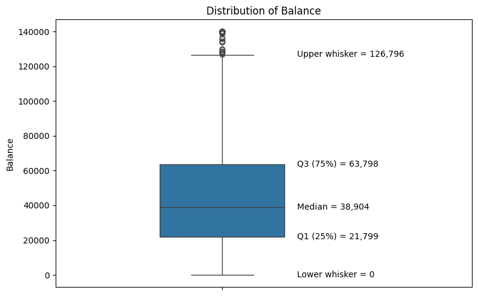

Balances are skewed toward lower amounts. The median is $38,904 and the mean is $45,445, so a smaller number of large balances pulls the average up. A quarter of customers hold $21,799 or less, and a quarter hold $63,798 or more. The lower whisker is $0 (95 customers have a zero balance). The upper whisker is about $126,796, with a handful of balances above that, up to $140,000.

### 4.2. How churners differ from customers who stay

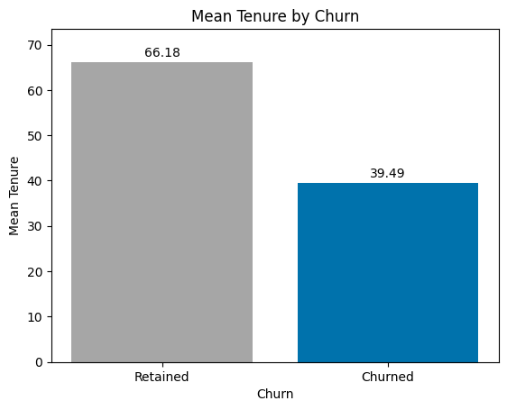

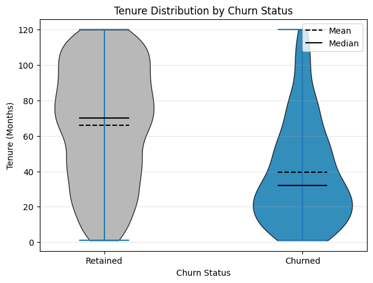

Tenure is the clearest gap. Customers who stayed have been with the bank for 66.2 months on average (median 70). Customers who left averaged 39.5 months (median 32). The retained distribution covers the full range up to 120 months. The churned distribution piles up at the short end, with a thin tail of longer relationships. Grouped the same way as in the notebook, churn is 34.6% for up to 40 months (176 of 509), 16.1% for 41–80 months (90 of 559), and 5.8% for 81–120 months (31 of 532).

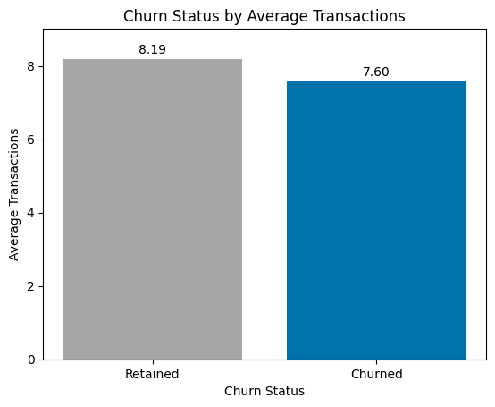

The average gap in recent transactions is small: 8.19 for retained customers and 7.60 for churned customers. On its own, one extra transaction does not separate the two groups. The grouped rates are clearer. Customers with up to 6 transactions churn at 21.9% (106 of 483), those with 7–12 at 18.0% (181 of 1,008), and those with 13–18 at 9.2% (10 of 109).

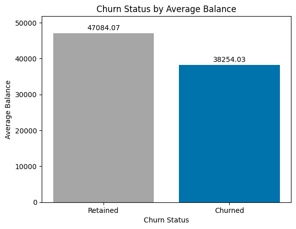

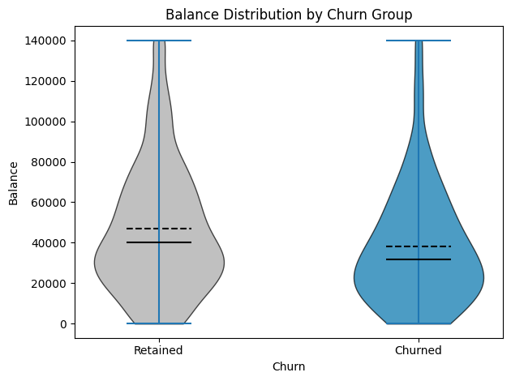

Churned customers hold less. The average balance is $47,084 for people who stayed and $38,254 for people who left. Medians are $40,180 and $31,815. On the violin plot the dashed line is the mean and the solid line is the median. Both groups cover the full range from $0 to about $140,000, and the churned group is denser at the lower balances. The correlation with churn is −0.11, so balance is a real difference and a weaker one than tenure.

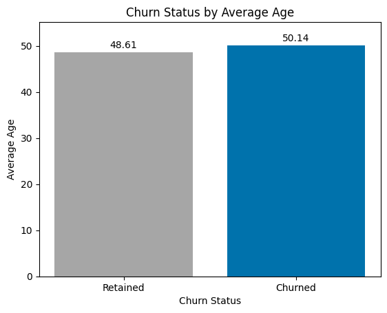

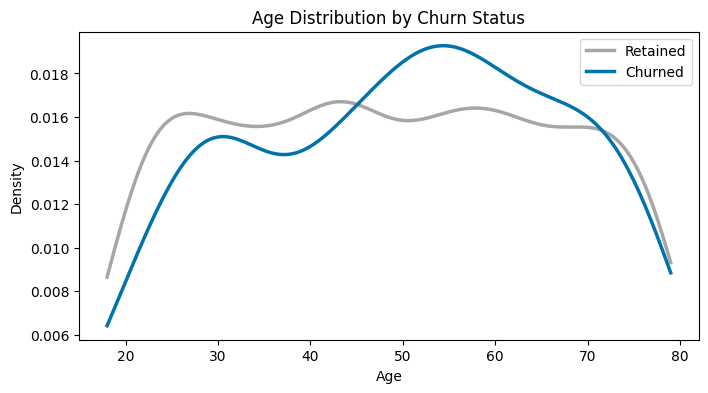

Age barely separates the two groups. The averages are 48.6 and 50.1. The density curves overlap from 18 to 79. Churned customers are a little more concentrated through the 50s, and the retained curve is flatter. Grouped rates sit close to the base rate: 16.2% up to age 39 (87 of 537), 21.0% for ages 40–59 (114 of 543), and 18.5% for ages 60 and over (96 of 520).

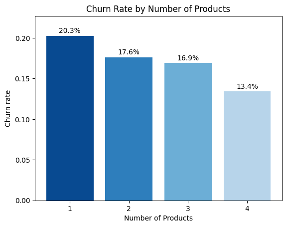

Churn eases as the product count rises: 20.3% with one product (153 of 755), 17.6% with two (99 of 562), 16.9% with three (34 of 201), and 13.4% with four (11 of 82). The last bar rests on 82 customers. The correlation with churn is −0.05. The slope is too shallow for product count to drive a contact list.

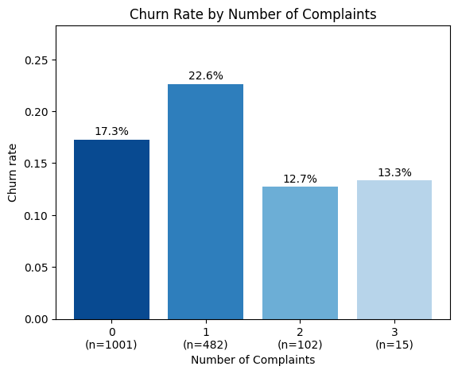

Complaints do not line up with churn in a steady way. No complaints is 17.3% (173 of 1,001). One complaint is higher, at 22.6% (109 of 482). Two complaints fall to 12.7% (13 of 102) and three complaints are 13.3% (2 of 15). The correlation with churn is 0.01. The two highest counts are small groups, so complaint count on its own is a weak signal.

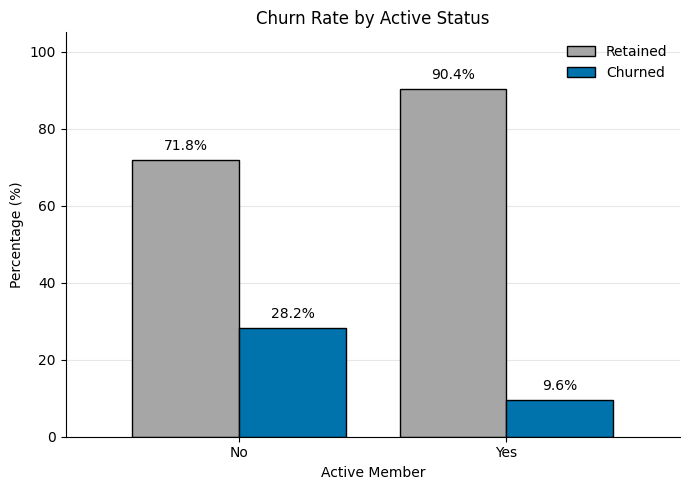

Activity is the second strong split. Inactive members churn at 28.2% (218 of 774). Active members churn at 9.6% (79 of 826). An inactive customer is about three times as likely to have left.

Gender, after the raw labels were standardised, is almost flat: 18.0% of women (145 of 806) and 19.1% of men (152 of 794). Both sit on the overall rate of 18.6%.

### 4.3. Which signals move together

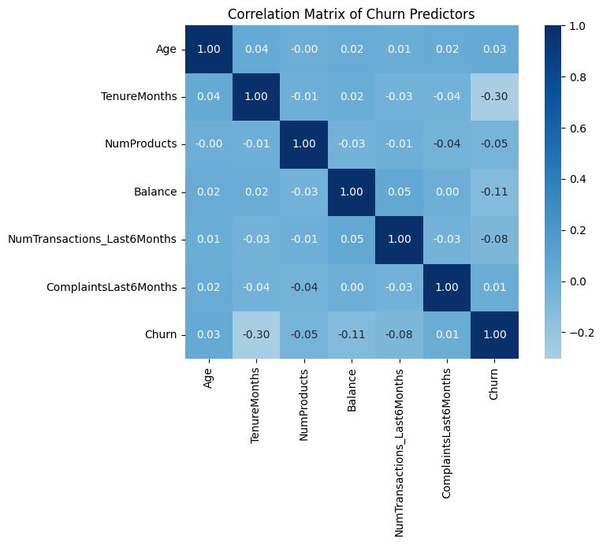

The numeric columns barely move together. The largest link with churn is tenure, at −0.30. Balance is −0.11 and recent transactions are −0.08. Age (0.03), products (−0.05), and complaints (0.01) are close to zero. `IsActiveMember` is stored as Yes or No, so it is absent from this matrix. The active-status chart above is the view of that field. Because the columns are not stand-ins for one another, a model can use more than one of them.

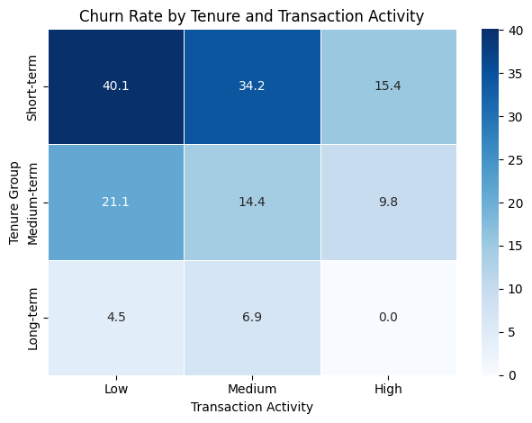

Risk stacks, and tenure dominates the grid. The cells are the churn rate in percent.

| Tenure | Low transactions | Medium | High |
| --- | ---: | ---: | ---: |
| Short-term (up to 40 months) | 40.1% (63 of 157) | 34.2% (107 of 313) | 15.4% (6 of 39) |
| Medium-term (41–80) | 21.1% (36 of 171) | 14.4% (50 of 347) | 9.8% (4 of 41) |
| Long-term (81–120) | 4.5% (7 of 155) | 6.9% (24 of 348) | 0.0% (0 of 29) |

Among short-term and medium-term customers, a quieter account churns more often. Among long-term customers every cell is low. The 0% cell is 29 people, so it is a small count. Short tenure and low activity together are 40.1%. Adding inactivity on top of that pair raises the rate to **59.2%** (45 of 76), against 22.2% (18 of 81) for short-tenure, low-activity customers who are still active.

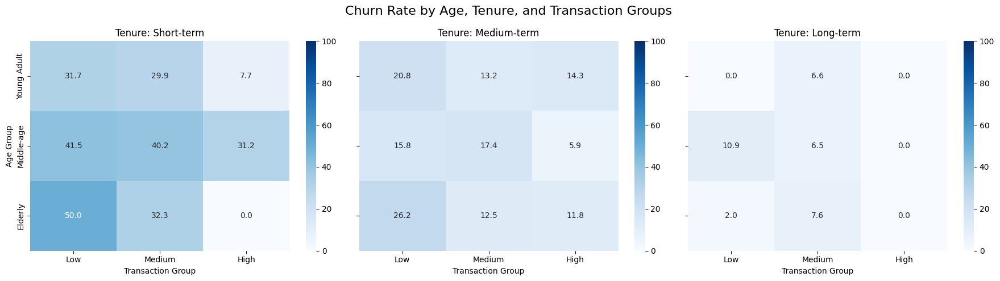

Splitting the same grid by age keeps the tenure pattern and shows where age matters. The darkest cell is elderly customers (60 and over) with short tenure and low transactions: 50.0% (22 of 44). Middle-aged short-tenure customers are also high, at 41.5% with low activity (22 of 53) and 40.2% with medium activity (43 of 107). Every long-tenure panel is pale, including the older customers. Age shifts the rate inside the short-tenure group. It does not produce a high-risk group among customers who have already stayed for years. Several high-activity cells are tiny, so a 0% tile is a small count.

Taken together, the charts point at four usable signals: a short relationship, an inactive membership, a quieter transaction history, and a lower balance. Age, gender, product count, and complaints were checked in the same pass and do not separate churners well enough to carry a contact rule on their own. The modelling section tests that reading formally before any field is kept.

## 5. ML Process

The work lives in `main.ipynb`.

Key modeling decisions:

- Cleaned gender labels before any modelling.
- Checked for missing values and duplicate customers. Neither needed repair.
- Used customer-level data as given. There is no transaction date, so the split is by customer, with the churn rate kept the same in train and test.
- Held out 20% of customers for a final check (1,280 train, 320 test) and tuned models with 5-fold stratified cross-validation.
- Judged models by **precision at 10%**: among the highest-risk tenth of customers, what share actually churned. Accuracy alone is a weak guide when most customers stay.
- Kept a feature only when an association test or a paired cross-validation test supported it (`p < 0.05`).
- Balanced class weights for logistic regression and the decision tree, so the minority class (churn) was not ignored.
- Left `CustomerID` out of training.
- Built tenure, transaction, and age groups for exploration. The model uses the underlying columns, through a preprocessing pipeline that scales numbers and encodes categories.

## 6. What the model uses

Features were tested separately for each model. Logistic regression, the model used for the contact list, keeps four:

| Feature | Why it is in the model |
| --- | --- |
| `TenureMonths` | Shorter relationships are much more likely to end. Correlation with churn is −0.30. |
| `IsActiveMember` | Inactive customers are concentrated in the high-risk list. |
| `NumTransactions_Last6Months` | Quieter customers churn more often. |
| `Balance` | High-risk customers tend to hold a lower balance. |

Age, gender, number of products, and recent complaints did not improve logistic regression enough to keep them.

Exploration groups, used in the charts and in the recommendations:

| Group | Cuts | Churn rate |
| --- | --- | --- |
| Short-term tenure | Up to 40 months | 34.6% |
| Medium-term tenure | 41–80 months | 16.1% |
| Long-term tenure | 81–120 months | 5.8% |
| Low transactions | Up to 6 in six months | 21.9% |
| Medium transactions | 7–12 | 18.0% |
| High transactions | 13–18 | 9.2% |

The risk stacks. Among short-tenure customers with low activity, churn is 40.1%. Among those who are also inactive, it is **59.2%** (76 customers), compared with 22.2% for short-tenure, low-activity customers who are still active.

## 7. Models and results

Four candidates were compared on the training customers with 5-fold stratified cross-validation. The tuning target for every model was precision at 10%. Logistic regression is the model taken through to the held-out test set and the contact list.

The charts below are the tuning and comparison figures from sections 6 and 7 of `main.ipynb`.

### 7.1. Logistic regression

Kept features: tenure, balance, transactions in the last six months, and active membership. Numeric columns are standardised. Active membership is encoded as 1 for Yes and 0 for No. The model uses balanced class weights.

`C` is the inverse of regularisation strength. Smaller `C` pulls the coefficients toward zero.

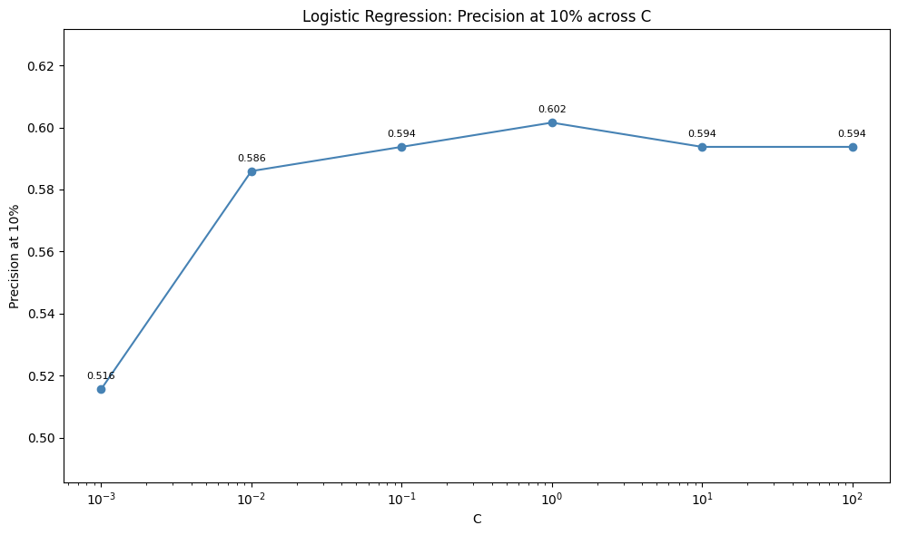

Precision at 10% rises from 0.516 at `C = 0.001` to a peak of **0.602 at** `C = 1`, then settles at 0.594 for `C = 10` and `C = 100`. The chosen setting is `C = 1`.

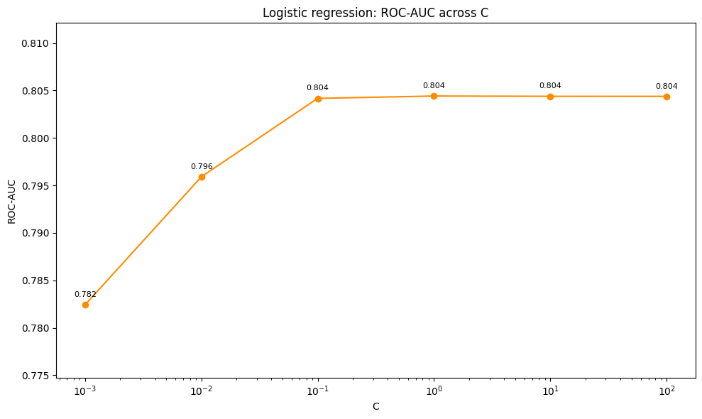

ROC-AUC tells the same story with a flatter top. It moves from 0.782 at the strongest penalty to 0.804 once `C` reaches 0.1, and it stays at 0.804 through `C = 100`. Extra freedom past `C = 1` does not improve the ranking.

### 7.2. Decision tree

The tree keeps the same four fields. It is not scaled, because a split uses the raw values. Class weights are balanced. `max_depth` limits how many splits a path can contain. `None` means the tree grows until the leaves are pure.

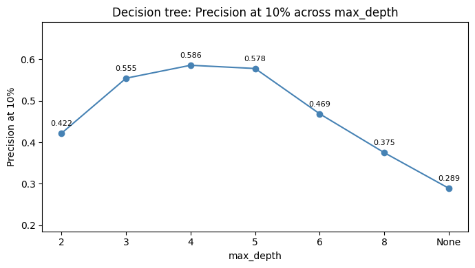

Precision at 10% climbs from 0.422 at depth 2 to **0.586 at depth 4**, then falls. Depth 5 is close, at 0.578. An unrestricted tree drops to 0.289, which is what overfitting looks like on this metric: the tree memorises the training folds and the top of the list gets worse. The chosen depth is 4.

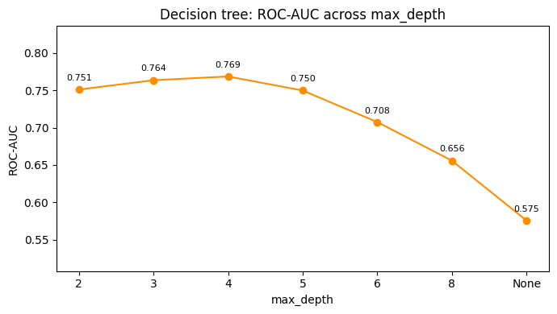

ROC-AUC peaks at the same depth, 0.769 at depth 4, and then declines to 0.575 with no depth limit. Depth 4 is the best tree on both charts.

### 7.3. K-nearest neighbours

KNN keeps the four fields above and also age. Distances are computed after scaling. `k` is the number of nearest training customers used to score a person.

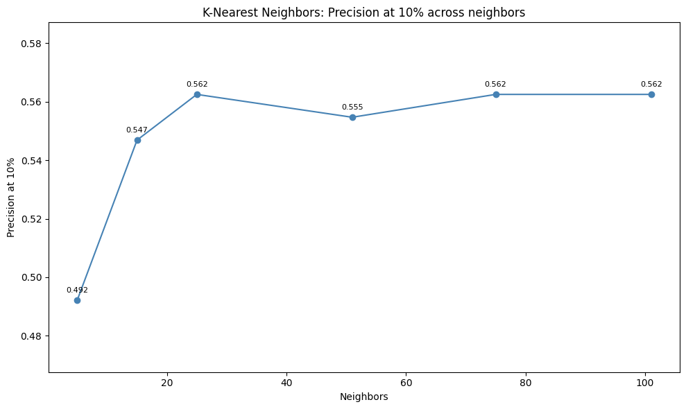

Precision at 10% is 0.492 at 5 neighbours, 0.547 at 15, and **0.562 at 25**. It dips to 0.555 at 51 and returns to 0.562 at 75 and 101. The first peak is `k = 25`, so that is the setting kept.

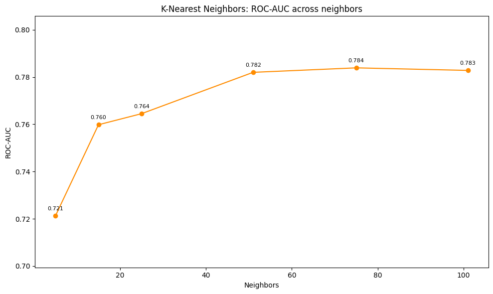

ROC-AUC keeps rising after the precision peak: 0.764 at 25 neighbours, 0.782 at 51, and 0.784 at 75. A larger neighbourhood ranks the whole book a little better. It does not put more real churners into the top 10%, which is the quantity the bank is tuning for.

### 7.4. Comparison

The baseline predicts that every customer stays. It has no ranking, so its precision at 10% is the training churn rate, 0.186, and its ROC-AUC is 0.50.

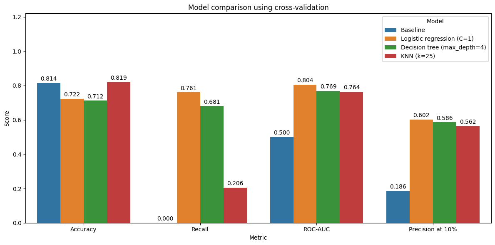

Scores are out-of-fold on the 1,280 training customers. Accuracy and recall use a 0.50 cutoff. Precision at 10% and ROC-AUC use the ranking.

| Model | Accuracy | Recall | ROC-AUC | Precision at 10% |
| --- | ---: | ---: | ---: | ---: |
| Baseline (everyone stays) | 0.814 | 0.000 | 0.500 | 0.186 |
| Logistic regression (`C = 1`) | 0.722 | 0.761 | 0.804 | **0.602** |
| Decision tree (depth 4) | 0.712 | 0.691 | 0.769 | 0.586 |
| KNN (`k = 25`) | 0.819 | 0.206 | 0.764 | 0.562 |

Logistic regression is the best list. Its top tenth is 60.2% churners, against 58.6% for the tree, 56.2% for KNN, and 18.6% for a random tenth. It also has the highest ROC-AUC, 0.804, and it finds 76.1% of churners at the 0.50 cutoff.

KNN has the highest accuracy, 0.819, because it mostly predicts that people stay. Its recall is 0.206, so that accuracy does not produce a useful call list. The baseline’s accuracy of 0.814 has the same cause: it never flags a churner.

The tree is close on the contact-list metric and worse on recall and ROC-AUC. Logistic regression is the simpler score to explain, and it wins the metric the outreach decision uses.

### 7.5. Formula of the final model

The contact list uses logistic regression with `C = 1`, balanced class weights, and the four kept fields. The coefficients below are from the fit on the 1,280 training customers. Numeric inputs enter as z-scores from that same training set. `ActiveYes` is 1 when the customer is an active member and 0 when they are not.

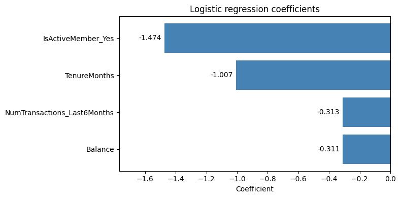

Every coefficient is negative. A longer relationship, a higher balance, more recent transactions, and an active membership each lower the chance of churn. Active membership (−1.474) and tenure (−1.007) dominate. Transactions (−0.313) and balance (−0.311) move the score by less.

The churn probability is

$$
P(\text{Churn} = 1) = \frac{1}{1 + e^{-\eta}}
$$

with

$$
\eta = 0.286 - 1.007 \cdot z_{\text{tenure}} - 0.311 \cdot z_{\text{balance}} - 0.313 \cdot z_{\text{transactions}} - 1.474 \cdot \text{ActiveYes}
$$

and

$$
z_{\text{tenure}} = \frac{\text{TenureMonths} - 61.054}{34.101}
$$

$$
z_{\text{balance}} = \frac{\text{Balance} - 46186.114}{32362.777}
$$

$$
z_{\text{transactions}} = \frac{\text{transactions} - 8.049}{2.840}
$$

`transactions` is `NumTransactions_Last6Months`. The three means and standard deviations are the training-set values used by the scaler. A customer at the training average on every numeric field, who is inactive, has $\eta = 0.286$ and a churn probability of about 0.57. Switching that same customer to active subtracts 1.474 from $\eta$ and drops the probability to about 0.23. One training-standard-deviation longer tenure, about 34 months, subtracts 1.007 and drops it to about 0.33.

### 7.6. Held-out test set

On the 320 test customers:

| Measure | Result | What it means |
| --- | --- | --- |
| Precision at 10% | 0.59 | 19 of the 32 highest-risk test customers had actually churned |
| Lift versus random | 3.2× | Test-set churn rate is 0.18, so the top of the list is about three times as concentrated |
| ROC-AUC | 0.782 | The ranking separates churners from stayers better than chance (0.50) |
| Recall at a 0.50 cutoff | 0.68 | The model flags about two-thirds of churners if every customer above 0.50 is treated as a risk |
| Accuracy | 0.71 | Useful context. The bank’s decision uses the ranking, because only a fraction of customers can be contacted |

## 8. Who to contact

The fitted logistic regression scores every customer. The recommended outreach list is the **top 10%**, which is **160 customers**. The lowest score on that list is about 0.79.

Sample of the highest-risk customers, from the notebook:

| CustomerID | Churn probability |
| --- | --- |
| C51488 | 0.95 |
| C21880 | 0.92 |
| C44377 | 0.92 |
| C47127 | 0.92 |
| C59986 | 0.92 |
| C37990 | 0.92 |
| C19210 | 0.92 |
| C36451 | 0.91 |
| C48753 | 0.91 |
| C59390 | 0.91 |

How those 160 people compare with everyone else:

| | Everyone else | Top 160 to contact |
| --- | ---: | ---: |
| Customers | 1,440 | 160 |
| Average tenure (months) | 65.9 | 19.1 |
| Inactive members | 43% | 99% |
| Average balance | $47,079 | $30,736 |
| Average transactions (last 6 months) | 8.2 | 6.9 |
| Average products | 1.75 | 1.78 |
| Average age | 49.0 | 47.6 |

The list is mostly newer, inactive customers with a lower balance. Age, gender, and product count barely differ, which matches dropping those fields from the model.

Using the test-set hit rate as the honest estimate:

| If the bank contacts 160 customers | Expected real churners |
| --- | ---: |
| Top 160 from the model | about 95 |
| 160 customers picked at random | about 30 |

The save rate is not in the data. If outreach keeps some of the churners who are contacted:

| Share of contacted churners who stay | Customers kept from the model list | Customers kept from a random list |
| --- | ---: | ---: |
| 10% | about 10 | about 3 |
| 20% | about 19 | about 6 |
| 30% | about 28 | about 9 |

These figures are a planning range. They assume the test-set precision carries over to the full contact list.

The full ranking is produced in section 8 of `main.ipynb`. It is not saved as a separate CSV.

## 9. Why a customer ranks high

The fitted equation is in section 7. A positive coefficient would push churn probability up, and a negative coefficient pushes it down. All four coefficients in the final model are negative. The business reading of the same model is visible in the contact list and the churn rates.

What raises risk:

- A short relationship with the bank. Tenure is the clearest pattern in the data.
- An inactive membership. Almost everyone on the contact list is inactive.
- A quieter recent transaction history.
- A lower balance, which shows up in the high-risk group even though it is a weaker signal than tenure and activity.

What the model does not treat as a reason to call:

- Gender
- Age band
- Number of products
- Complaint count, on its own

A single flag is a weak rule. Short tenure and inactivity together are much more informative than either one alone. That is why the score is more useful than a hand-built filter on one column.

## 10. Business insights

**Call newer, inactive customers first.** Short-tenure churn is 34.6%, against 5.8% for long-tenure customers. On the recommended list, average tenure is 19 months and 99% are inactive.

**Low activity is a warning, especially early on.** Customers with few recent transactions churn at 21.9%, against 9.2% for the most active group. Short-tenure customers who are inactive and quiet churn at 59.2%.

**Spend the outreach budget on a ranked list.** Contacting the top 10% is expected to reach about 95 churners, against about 30 from a random list of the same size.

**Long-tenure, active customers are a lower priority for this campaign.** Their churn rate is already low. Retention effort there is better aimed at service and relationship maintenance than at an urgent save offer.

**The score should support the decision, not replace it.** A high probability means the customer looks like people who have already left. Whether to call still depends on offer cost, what the bank can realistically save, relationship value, and any context this dataset does not contain, such as a complaint in progress or a known move overseas.

## 11. Project structure

```text
DSB102 Customer Churn/
├── main.ipynb                          # Full analysis, from cleaning to the contact list
├── data/
│   └── sydney_bank_customer_churn.csv  # One row per customer
├── figures/                            # Exploratory charts and model comparison charts
├── report/
│   └── Reports.pdf                     # Written report
├── presentation/
│   └── Presentation.pdf                # Slide deck
├── README.md
└── .gitignore
```

| Output | Where it is |
| --- | --- |
| Exploratory charts and the reading of each one | Section 4 of this file, image files in `figures/` |
| Model tuning charts, comparison, and the final formula | Section 7 of this file, image files in `figures/` |
| Cleaned data, charts, tests, and model comparison | `main.ipynb` |
| Test-set metrics and the 160-person contact list | `main.ipynb`, section 7 and section 8 |
| Written interpretation and recommendations | `report/Reports.pdf` |
| Summary for a presentation | `presentation/Presentation.pdf` |

## 12. How to run

Packages used in the notebook:

```bash
pip install numpy pandas matplotlib seaborn scikit-learn scipy jupyter
```

Open `main.ipynb` and run the cells from top to bottom. Loading the data needs a network connection, because the notebook reads the CSV from GitHub. The same file is in `data/` if that URL is unavailable.

## 13. Limitations

- The table is a snapshot of customers, with no outcome date. The model describes who resembles customers that have already left. It is not a forecast of a future month.
- Only four fields drive the final score. Fees, competitors, service contacts, life events, and the offer the bank might make are not in the data.
- The 10%, 20%, and 30% save rates are assumptions for planning. The dataset does not record whether a retention offer worked.
- The 160-person list scores the full customer table, including people the model was trained on. The performance claim uses the held-out test set. The “about 95 churners” figure applies that test-set hit rate to the list.
- Results come from 1,600 customers at one bank. A new book of customers, or a different product mix, would need the same checks again.

## 14. Conclusion

The project gives Sydney Bank a ranked retention list instead of a guess.

The modelling choices match that decision: a customer-level target, a split that preserves the churn rate, a metric aimed at the top 10% the bank can actually contact, a simple baseline, and a model that can be explained from tenure, activity, transactions, and balance.

On unseen customers, the top of the list is about 3.2 times as concentrated with churners as a random sample. The people on it are overwhelmingly newer and inactive. That is the group a retention team should work through first, with the score used alongside offer cost and what the bank already knows about the customer.
